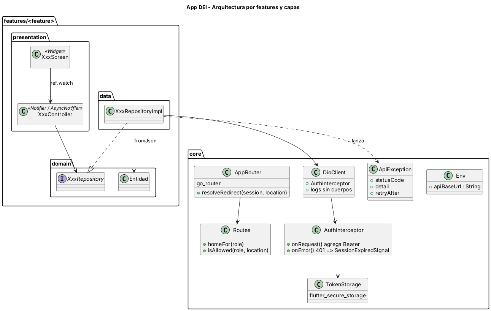
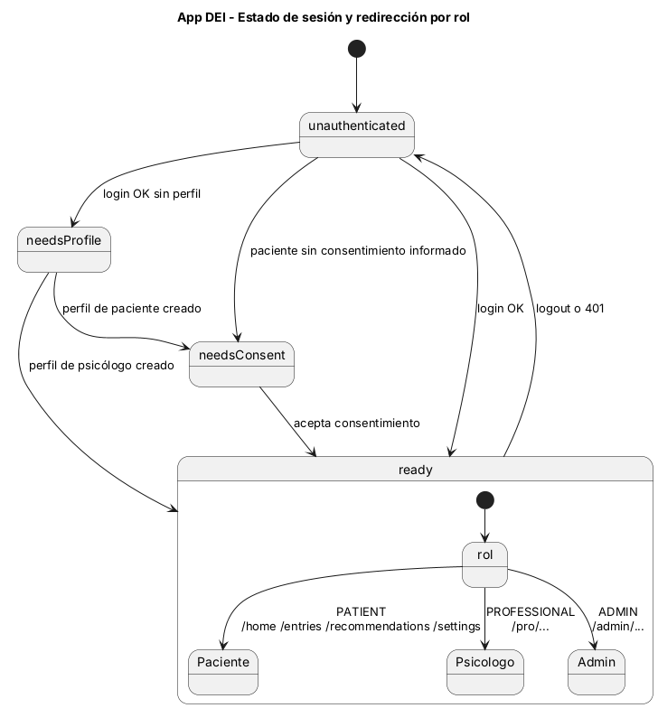
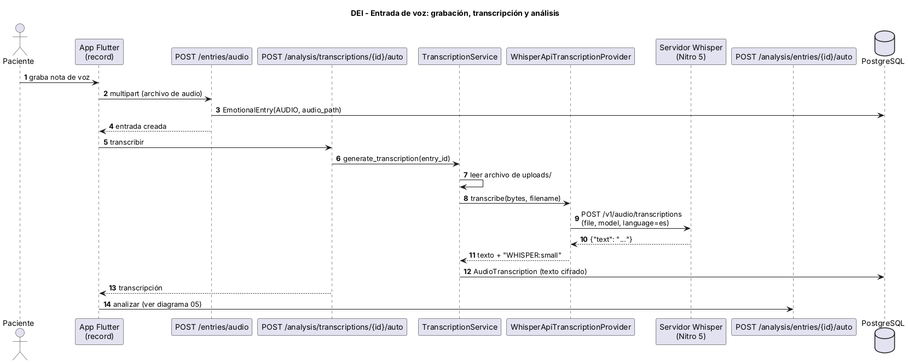

# DEI · App (`dei_app`, Flutter)

Una sola app Flutter para **Android, iOS y web** con los tres roles: paciente,
psicólogo y administrador. Al iniciar sesión la navegación cambia según el rol.
En teléfonos usa barra inferior y en pantallas anchas un menú lateral. Solo habla
con la API de `dei_backend`.

Ver también: [arquitectura general](arquitectura-general.md) ·
[backend](backend.md) · [IA local](ia.md). El README del proyecto Flutter tiene
la guía de instalación paso a paso (FVM, emuladores, compilación).

---

## 1. Arquitectura

Organizada **por features**, cada una con tres capas:

```
lib/
  main.dart, app.dart
  core/
    config/env.dart          API_BASE_URL (--dart-define)
    network/                 DioClient + AuthInterceptor, ApiException
    storage/token_storage    JWT en flutter_secure_storage
    router/                  go_router, Routes, resolveRedirect
    theme/, widgets/, utils/ Tema, AdaptiveShell, componentes, validadores, textos
  features/<feature>/
    domain/        Entidades + interfaz del repositorio (sin Flutter ni Dio)
    data/          Implementación del repositorio contra la API
    presentation/  Controladores Riverpod + pantallas
```



| Decisión | Detalle |
|---|---|
| Estado | Riverpod 3 (`Notifier` / `AsyncNotifier`), sin generación de código. |
| Dependencias de capas | `presentation → domain ← data`. Los controladores dependen de la interfaz del repositorio; las pruebas la sustituyen con mocktail. |
| Sin casos de uso | Los controladores llaman al repositorio directamente; para este tamaño evita código repetido. |
| Red | Un `Dio` compartido. `AuthInterceptor` agrega el `Bearer` y, ante un 401 con token, emite `SessionExpiredSignal` y la sesión se cierra. |
| Errores | La capa de datos solo lanza `ApiException` (sin conexión, 400, 401, 403, 404, 422, 429 con `Retry-After`, 503 IA no disponible) con el `detail` del backend en español. |
| Privacidad | El log de red en debug nunca imprime cuerpos, porque contienen el diario. El token vive en almacenamiento seguro. |

## 2. Features

| Feature | Rol | Qué hace |
|---|---|---|
| `auth` | Todos | Splash, login, registro (paciente o psicólogo), recuperar contraseña en 3 pasos, `SessionController`. |
| `profile` | Paciente | Completar perfil al primer ingreso, ajustes. |
| `consents` | Paciente | Consentimiento informado obligatorio, IA opcional y revocable. |
| `entries` | Paciente | Lista, nueva entrada de texto o voz (`record`), detalle, archivar. |
| `analysis` | Paciente | Emoción, intensidad, riesgo y temas; tarjeta de crisis con botón para llamar (`url_launcher`). |
| `home` | Paciente | Resumen semanal y contador de notificaciones. |
| `recommendations` | Paciente | Lista (las pendientes se ven "en revisión") y pedir una nueva. |
| `therapy` | Paciente | Directorio de psicólogos verificados, solicitud con modo de compartir, dar o quitar acceso. |
| `notifications` | Paciente, psicólogo | Lista y marcar leída. |
| `professional` | Psicólogo | Panel, solicitudes, pacientes, ficha (insights, entradas compartidas, sesiones), alertas de riesgo, revisión de recomendaciones, sesiones y notas. |
| `admin` | Admin | Métricas, usuarios, verificación de psicólogos, orden de proveedores de IA (arrastrar), líneas de crisis. |

La tabla completa de pantallas y endpoints está en el README de la app.

## 3. Sesión y navegación

`SessionController` reduce todo a un estado (`unauthenticated`, `needsProfile`,
`needsConsent`, `ready`). Con ese estado y el rol, `resolveRedirect` (función
pura, probada sin widgets) decide la pantalla:

- Sin sesión, solo rutas públicas (`/login`, `/register`, `/forgot-password`,
  `/reset-password`).
- Paciente o psicólogo sin perfil van a `/onboarding/...`.
- Paciente sin consentimiento informado va a `/onboarding/consent`.
- Con todo listo, cada rol solo puede abrir su árbol: paciente (`/home`,
  `/entries`, `/recommendations`, `/settings`), psicólogo (`/pro/...`), admin
  (`/admin/...`). Escribir otra URL en la web redirige a su inicio.



Cambiar el rol de un usuario no existe en la app a propósito: subir a alguien a
administrador desde la interfaz sería un riesgo. El primer admin se crea en la
base de datos.

## 4. Comunicación con el backend

| Aspecto | Cómo |
|---|---|
| URL | `--dart-define-from-file=config/<entorno>.json` (`android-emulator.json` → `10.0.2.2:8000`, `local.json` → `localhost:8000`, `device.local.json` → IP de la PC). |
| Login | `POST /auth/login` como formulario OAuth2; el JWT se guarda y se valida con `GET /auth/me`. |
| Audio | Multipart a `POST /entries/audio`, luego transcribir y analizar. |
| IA lenta o caída | 503 → mensaje "la IA no está disponible"; la entrada ya quedó guardada y se puede analizar después. |
| Compatibilidad | Si el backend no tiene los endpoints de la PR #4, la app arma la lista de pacientes desde sesiones y alertas y muestra un aviso. |
| Producción | Solo `https` (en Android el `http` está permitido únicamente en debug). Para web, el origen debe estar en `CORS_ORIGINS`. |



## 5. Tecnologías

Flutter 3.50 (fijado con FVM en `.fvmrc`), Dart 3.14, `flutter_riverpod` 3,
`go_router` 18, `dio` 5, `flutter_secure_storage` 11, `record` 7,
`path_provider`, `url_launcher`, `intl`. Pruebas con `flutter_test` y
`mocktail`.

## 6. Calidad

```bash
fvm flutter analyze   # sin avisos
fvm flutter test      # 27 pruebas
```

Las pruebas cubren validadores, `ApiException`, modelos, redirección por rol,
recuperación de contraseña y el repositorio del psicólogo.

## 7. Pendiente

- Probar contra el backend real en un dispositivo físico.
- Íconos y splash nativos con la marca de DEI.
- Notificaciones push.
- Subir la app a un repositorio propio (hoy se comparte como zip).
