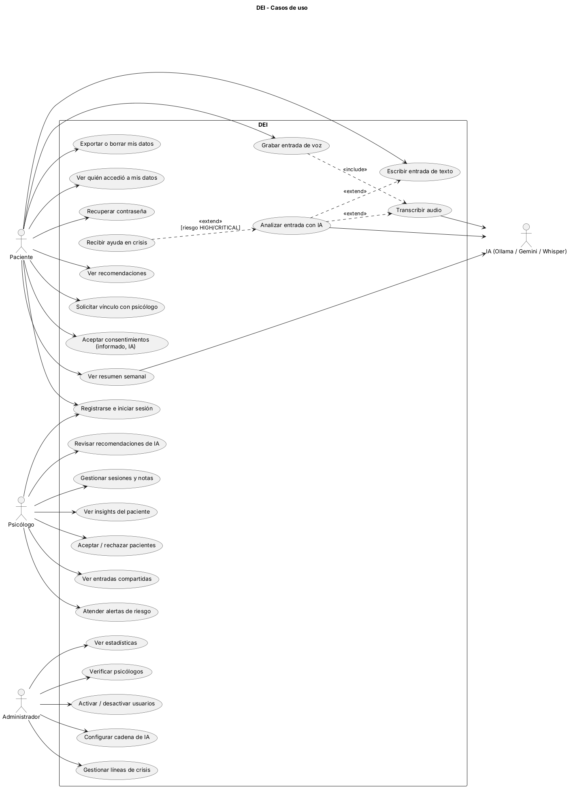
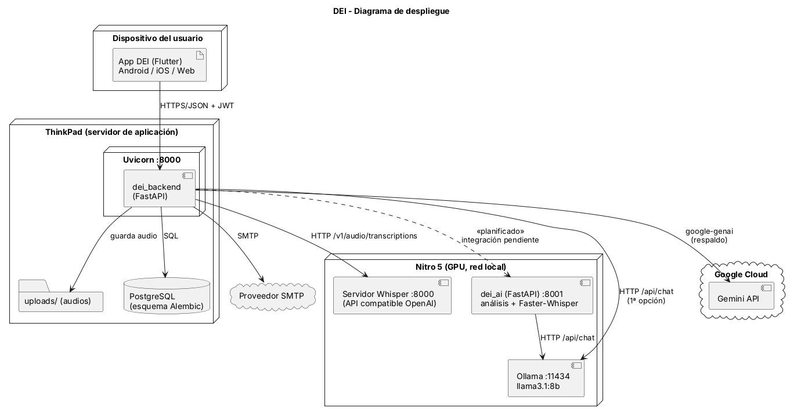
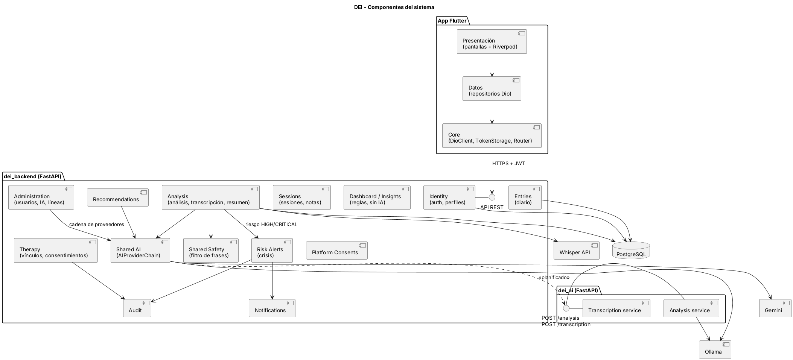
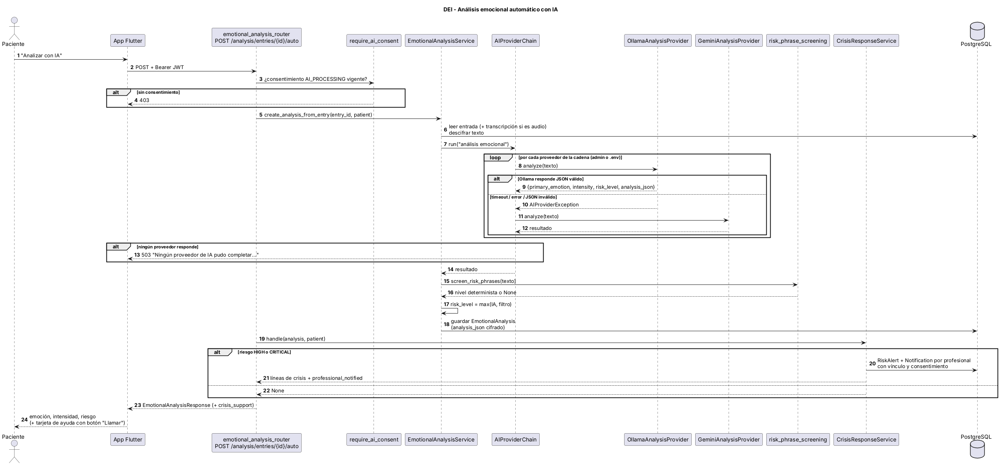
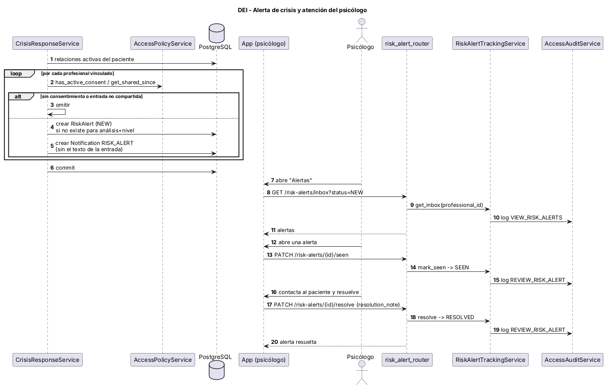
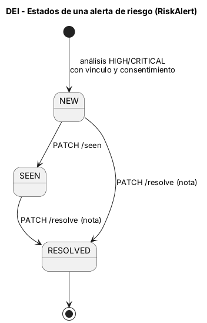
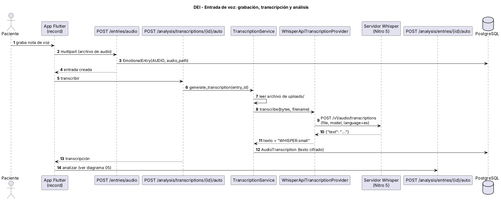
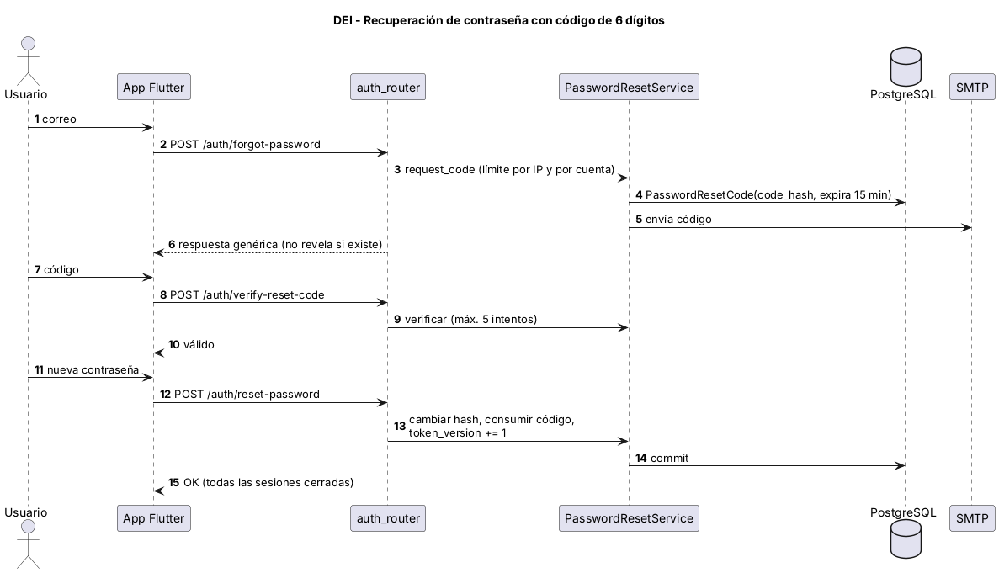
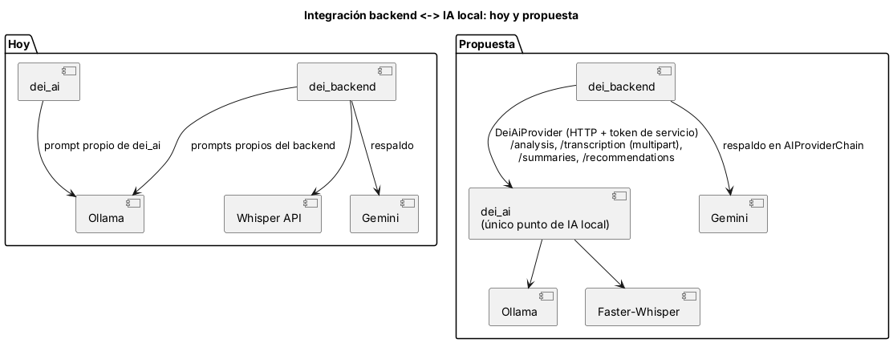

# DEI · Arquitectura general

**DEI (Diario Emocional Inteligente)** es una plataforma de acompañamiento
psicológico: el paciente escribe o graba su diario, una IA analiza cada entrada
(emoción principal, intensidad, nivel de riesgo y temas), y el psicólogo con el
que el paciente decide vincularse ve lo que este le comparte, recibe alertas de
riesgo y revisa las recomendaciones que propone la IA. Un administrador verifica
a los psicólogos y configura la plataforma.

Este documento une las tres piezas. Cada una tiene su propio documento:

| Componente | Repositorio | Documento |
|---|---|---|
| Backend (API REST) | `dei_backend` | [backend.md](backend.md) |
| App (Android, iOS, web) | `dei_app` (Flutter) | [app.md](app.md) |
| IA local | `dei_ai` | [ia.md](ia.md) |

Los diagramas están en [`diagramas/`](diagramas/) en tres formatos: fuente
PlantUML (`plantuml/`), imagen (`png/`, `svg/`) y modelo UML importable en
Enterprise Architect (`enterprise-architect/`). Cómo importarlos: sección 8.

---

## 1. Vista de contexto

| Actor | Qué hace en DEI |
|---|---|
| **Paciente** | Registra entradas de texto o voz, ve su análisis y su resumen semanal, recibe recomendaciones, elige con qué psicólogo compartir y desde cuándo, y puede exportar o borrar sus datos. |
| **Psicólogo** | Acepta pacientes, ve solo las entradas que cada paciente le comparte, atiende alertas de riesgo, agenda sesiones con notas clínicas y aprueba o rechaza las recomendaciones de la IA. |
| **Administrador** | Verifica licencias de psicólogos, activa o desactiva usuarios, elige el orden de los proveedores de IA y mantiene las líneas de crisis por país. |
| **IA** (sistema externo) | Transcribe audio (Whisper) y genera análisis, resúmenes semanales y recomendaciones (Ollama local o Gemini en la nube). Los insights del psicólogo se calculan con reglas, sin IA. |



## 2. Despliegue

Hoy el sistema corre en una red local con dos máquinas, más servicios en la nube:

- **ThinkPad**: backend FastAPI (Uvicorn, puerto 8000), PostgreSQL y la carpeta
  `uploads/` con los audios.
- **Nitro 5** (con GPU): Ollama (`llama3.1:8b`, puerto 11434), un servidor
  Whisper compatible con la API de OpenAI y el servicio `dei_ai` (puerto 8001).
- **Nube**: Gemini como respaldo de la IA local y un servidor SMTP para los
  códigos de recuperación de contraseña.
- **Dispositivo del usuario**: la app Flutter, que solo habla con el backend.



## 3. Componentes y responsabilidades



- **La app nunca habla con la IA ni con la base de datos.** Todo pasa por la API
  del backend con un JWT.
- **El backend es la única fuente de verdad** de reglas clínicas: consentimientos,
  quién puede ver qué, detección de riesgo, alertas y auditoría.
- **La IA es reemplazable.** El backend prueba los proveedores en el orden que
  define el administrador (`OLLAMA,GEMINI` por defecto) mediante
  `AIProviderChain`. Si ninguno responde, la API devuelve 503 y la entrada queda
  guardada para analizarla después.

## 4. Flujos clave

### 4.1 Análisis emocional con IA

1. El paciente crea una entrada (texto o voz). Si es voz, primero se transcribe
   con Whisper.
2. La app pide `POST /analysis/entries/{id}/auto`. El backend exige el
   consentimiento `AI_PROCESSING`.
3. `AIProviderChain` prueba Ollama y, si falla, Gemini.
4. **El filtro determinista de frases de riesgo corre siempre**, y si detecta un
   riesgo mayor que el de la IA, gana el filtro.
5. El análisis se guarda cifrado. Si el riesgo es HIGH o CRITICAL se dispara la
   respuesta de crisis (4.2).



### 4.2 Alerta de crisis

Con riesgo HIGH o CRITICAL, la respuesta al paciente incluye las líneas de
crisis de su país (con botón para llamar) y el backend crea una `RiskAlert` y una
notificación para cada psicólogo con **vínculo activo, consentimiento vigente y
acceso a esa entrada**. La notificación no incluye el texto del diario. El
psicólogo ve la alerta, la marca como vista y la resuelve con una nota; cada paso
queda en la auditoría.




### 4.3 Entrada de voz



### 4.4 Recuperación de contraseña



## 5. Integración backend ↔ IA local

**Estado actual.** El backend **no consume todavía el servicio `dei_ai`**: llama
directamente a Ollama (`/api/chat`) con sus propios prompts y a un servidor
Whisper compatible con OpenAI. `dei_ai` es un servicio aparte que también usa
Ollama y Faster-Whisper, con su propio prompt y su propio esquema de respuesta.
Hay dos prompts de análisis que mantener y dos lugares donde normalizar
emociones y niveles de riesgo.

**Propuesta.** Que `dei_ai` sea el único punto de entrada a la IA local y que el
backend lo use como un proveedor más de la cadena (`DEI_AI`, antes de `GEMINI`):



Cambios necesarios (detalle en [ia.md](ia.md#6-integración-con-el-backend)):

1. En `dei_ai`: transcripción por multipart (hoy recibe una ruta de archivo
   local, que no sirve entre máquinas), endpoints de resumen y recomendaciones
   (los contratos existen pero están vacíos) y un token de servicio.
2. En `dei_backend`: un `DeiAiProvider` para análisis, resumen y recomendaciones,
   y un `DeiAiTranscriptionProvider`, registrados en las fábricas actuales.
3. Unificar el contrato: `dei_ai` ya responde con los mismos campos que espera el
   backend (`primary_emotion`, `emotion_intensity`, `risk_level`, `provider`,
   `model`, `analysis_json`); falta alinear la lista de emociones (el backend
   tiene 22, `dei_ai` 20).

El filtro de frases de riesgo y la decisión final del nivel de riesgo se quedan
en el backend, sea cual sea el proveedor.

## 6. Seguridad y privacidad (resumen)

| Tema | Cómo se resuelve |
|---|---|
| Autenticación | JWT HS256 (30 min). `token_version` invalida todas las sesiones al cambiar la contraseña. |
| Autorización | Roles PATIENT, PROFESSIONAL y ADMIN en el backend; la app además bloquea rutas por rol. |
| Cifrado en reposo | Texto del diario, transcripciones, `analysis_json`, recomendaciones y notas clínicas, con `DATA_ENCRYPTION_KEYS` (el backend no arranca sin clave). |
| Consentimientos | Consentimiento informado obligatorio; consentimiento de IA opcional y revocable; consentimiento por psicólogo con modo de compartir (todo, desde una fecha, solo nuevas). |
| Auditoría | Cada vez que un psicólogo ve datos o alertas de un paciente queda registrado, y el paciente puede consultarlo. |
| Derechos del paciente | Exportar y borrar sus datos. |
| IA simulada | `FAKE` no se permite con `APP_ENV=production`. |

Detalle completo en `docs/seguridad-clinica-y-privacidad.md` del backend.

## 7. Tecnologías

| Capa | Tecnología |
|---|---|
| App | Flutter 3.50 (FVM), Dart 3.14, Riverpod 3, go_router 18, Dio 5, flutter_secure_storage, record |
| Backend | Python, FastAPI 0.136, SQLAlchemy 2, Alembic, PostgreSQL, python-jose, passlib/bcrypt, cryptography, httpx, google-genai |
| IA local | FastAPI 0.141, pydantic-settings, Ollama (`llama3.1:8b`), faster-whisper 1.2 (`large-v3`) |
| Pruebas | pytest (backend e IA), flutter_test + mocktail (app) |

## 8. Diagramas y Enterprise Architect

| # | Diagrama | Tipo UML |
|---|---|---|
| 01 | Despliegue | Despliegue |
| 02 | Componentes del sistema | Componentes |
| 03 | Casos de uso | Casos de uso |
| 04 | Modelo de datos | Clases / ER |
| 05 | Análisis emocional con IA | Secuencia |
| 06 | Alerta de crisis | Secuencia |
| 07 | Entrada de voz | Secuencia |
| 08 | Estados de una alerta | Máquina de estados |
| 09 | Recuperación de contraseña | Secuencia |
| 10 | Capas de la app | Clases |
| 11 | Sesión y navegación de la app | Máquina de estados |
| 12 | Clases de `dei_ai` | Clases |
| 13 | `POST /analysis` en `dei_ai` | Secuencia |
| 14 | Integración backend ↔ IA | Componentes |

### Importar en Enterprise Architect

**Opción A: modelo UML (XMI 2.1).** `enterprise-architect/dei-modelo.xmi` trae
los elementos del modelo listos para usar: actores y casos de uso (con
`include`/`extend`), componentes y sus dependencias, nodos de despliegue y las
19 entidades de la base de datos con atributos, tipos y asociaciones.

1. En el *Project Browser*, selecciona (o crea) un paquete raíz.
2. *Publish → Import/Export → Import Package from XMI* (en versiones antiguas:
   clic derecho en el paquete → *Import/Export → Import package from
   XML/XMI*).
3. Elige `dei-modelo.xmi` y pulsa *Import*.
4. Crea un diagrama en cada paquete y arrastra los elementos desde el
   *Project Browser* (o usa *Insert Related Elements* para traer las
   relaciones). El XMI estándar no lleva posiciones de diagrama, por eso EA
   importa los elementos pero no dibuja el diagrama solo.

**Opción B: PlantUML.** Las versiones recientes de Enterprise Architect pueden
importar scripts PlantUML directamente en un diagrama (busca *Import PlantUML*
en el menú del diagrama; el nombre exacto depende de tu versión). Así se
reconstruyen también los diagramas de secuencia y de estados, que el XMI no
incluye. Si tu versión no lo tiene, usa los PNG/SVG como referencia y redibuja
las secuencias a partir de los elementos importados.

**Regenerar el modelo de datos** después de cambiar los modelos del backend:

```bash
python tools/gen_model.py <ruta-a-dei_backend> diagramas
java -jar plantuml.jar -tpng -o ../png diagramas/plantuml/*.puml
```
