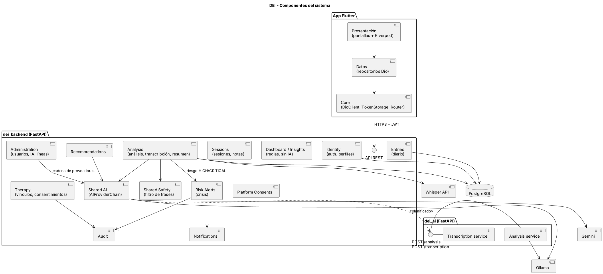
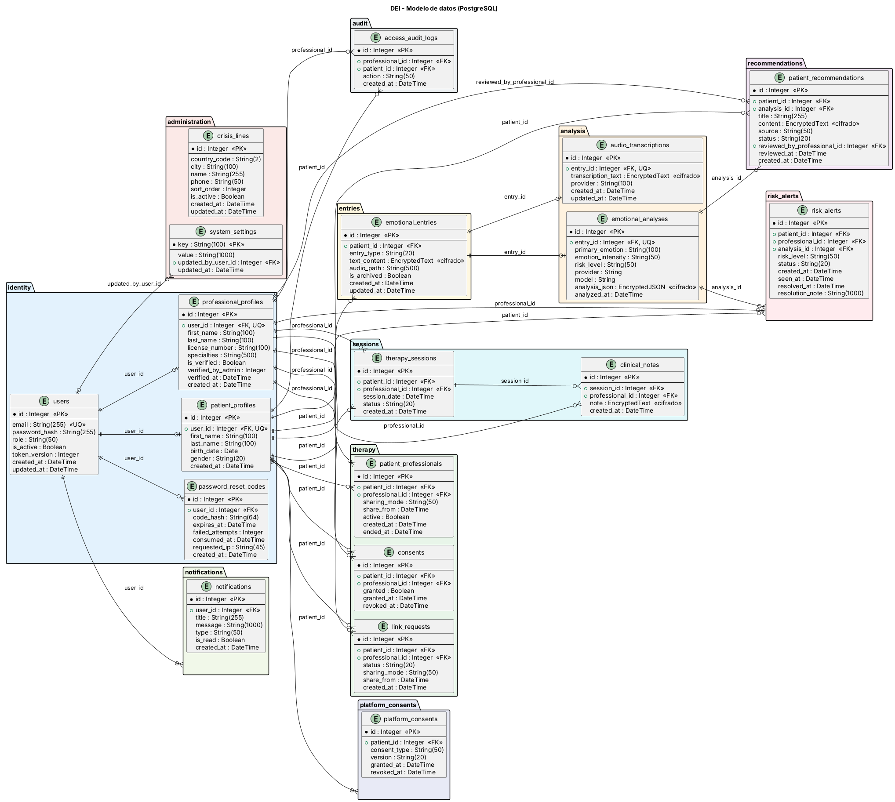
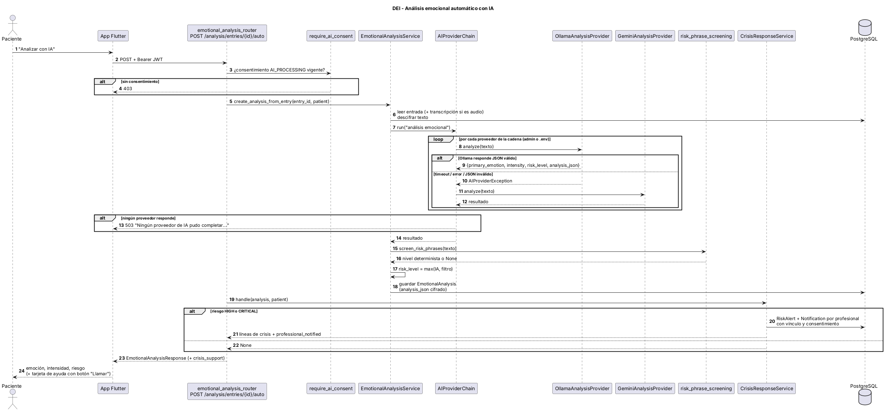
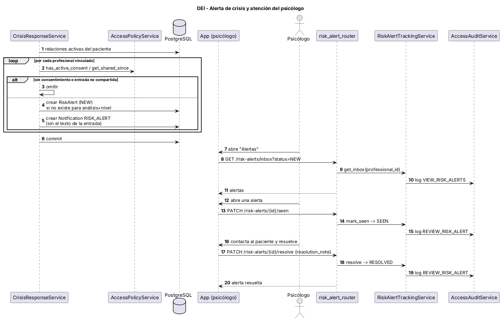

# DEI · Backend (`dei_backend`)

API REST de DEI en **FastAPI**. Concentra las reglas clínicas: autenticación y
roles, consentimientos, qué ve cada psicólogo, análisis con IA, detección de
riesgo, alertas, auditoría y administración. La app Flutter es su único cliente.

Ver también: [arquitectura general](arquitectura-general.md) · [app](app.md) ·
[IA local](ia.md).

> Este documento describe la rama con las PR #1 a #4 (IA local, seguridad
> clínica, recuperación de contraseña y panel del psicólogo).

---

## 1. Estructura

El código está organizado **por módulo de negocio**, y cada módulo repite las
mismas capas:

```
app/
  main.py                FastAPI, CORS, manejador de errores de IA (503), routers
  core/                  config (.env), database, dependencies (JWT, roles),
                         security (bcrypt, JWT), rate_limit, logging
  <modulo>/
    routers/             Endpoints HTTP (validación con Pydantic y dependencias)
    services/            Reglas de negocio
    repositories/        Acceso a datos (SQLAlchemy)
    models/              Tablas
    schemas/             Pydantic: entrada y salida de la API
    providers/           (módulos con IA) implementaciones por proveedor
  shared/
    ai/                  AIProviderChain, clientes Ollama y Gemini, cadena en caliente
    safety/              Filtro de frases de riesgo, líneas de crisis
    security/            Cifrado de campos (Fernet)
    email/               Envío SMTP
    enums/, emotions.py  Catálogos compartidos
alembic/                 Migraciones (única forma de cambiar el esquema)
tests/                   pytest (66 pruebas, IA simulada)
docs/                    Guías: base de datos, IA local, seguridad, recuperación
```

**Flujo de una petición:** `router` → dependencias (`get_db`,
`get_current_user`, rol, consentimientos) → `service` → `repository` → modelo.
Los servicios lanzan `HTTPException` con mensajes en español; la app los muestra
tal cual.

## 2. Módulos

| Módulo | Responsabilidad |
|---|---|
| `identity` | Registro, login (OAuth2 form), `/auth/me`, recuperación de contraseña, perfiles de paciente y psicólogo, exportar/borrar datos del paciente, portal del psicólogo. |
| `therapy` | Solicitudes de vínculo paciente → psicólogo, relación activa, consentimiento por psicólogo y política de acceso (`AccessPolicyService`). |
| `platform_consents` | Consentimiento informado (obligatorio) y de procesamiento con IA (opcional), versionados. Dependencias `require_informed_consent` y `require_ai_consent`. |
| `entries` | Entradas del diario de texto o audio, archivar. |
| `analysis` | Transcripción (Whisper), análisis emocional, resumen semanal. |
| `recommendations` | Recomendaciones generadas por IA; quedan pendientes hasta que el psicólogo las aprueba o rechaza. |
| `risk_alerts` | Respuesta de crisis y bandeja de alertas del psicólogo (NEW → SEEN → RESOLVED). |
| `sessions` | Sesiones de terapia y notas clínicas cifradas. |
| `notifications` | Notificaciones dentro de la app. |
| `dashboard` / `therapy_insights` | Paneles de paciente y psicólogo; insights por reglas. |
| `administration` | Usuarios, verificación de psicólogos, estadísticas, cadena de IA y líneas de crisis. |
| `audit` | Registro de accesos del psicólogo a datos de pacientes. |
| `health` | `GET /health/ai`: estado de Ollama, Gemini y la cadena activa. |



## 3. API

Todas las rutas, salvo registro, login y recuperación de contraseña, requieren
`Authorization: Bearer <JWT>`. La documentación interactiva está en `/docs`
(Swagger) al levantar el servidor.

| Prefijo | Endpoints | Rol |
|---|---|---|
| `/auth` | `POST register`, `POST login`, `GET me`, `POST forgot-password`, `POST verify-reset-code`, `POST reset-password` | Público / cualquiera |
| `/patients` | `POST profile`, `GET profile/me`, `GET me/data/export`, `POST me/data/erase` | Paciente |
| `/professionals` | `POST profile`, `GET profile/me`, `GET me/patients`, `GET me/patients/{id}/entries`, `GET directory`, `GET pending`, `PATCH {id}/verify` | Psicólogo (directorio: paciente; verificar: admin) |
| `/platform-consents` | `GET documents`, `POST`, `GET`, `PATCH {tipo}/revoke` | Paciente |
| `/therapy/link-requests` | `POST`, `GET pending`, `PATCH {id}/accept`, `PATCH {id}/reject` | Paciente / psicólogo |
| `/therapy/consents` | `POST`, `GET`, `PATCH {id}/revoke` | Paciente |
| `/entries` | `POST`, `POST audio`, `GET`, `GET {id}`, `PATCH {id}/archive` | Paciente |
| `/analysis/transcriptions` | `POST {entry_id}`, `PATCH {id}`, `POST {entry_id}/auto` | Paciente |
| `/analysis` | `POST entries/{id}`, `GET entries/{id}`, `POST entries/{id}/auto`, `POST entries/{id}/reanalyze`, `GET weekly-summary` | Paciente |
| `/recommendations` | `GET`, `POST analysis/{id}`, `POST generate/{id}`, `GET review/pending`, `PATCH review/{id}/approve`, `PATCH review/{id}/reject` | Paciente / psicólogo |
| `/risk-alerts` | `GET`, `GET inbox`, `PATCH {id}/seen`, `PATCH {id}/resolve` | Psicólogo |
| `/sessions` | `POST`, `GET`, `PATCH {id}/complete`, `PATCH {id}/cancel`, `POST/GET {id}/notes` | Psicólogo / paciente |
| `/notifications` | `GET`, `GET summary`, `PATCH {id}/read` | Paciente / psicólogo |
| `/dashboard` | `GET patient`, `GET professional` | Según rol |
| `/therapy-insights` | `GET patient/{id}` | Psicólogo |
| `/audit` | `GET my-access-log` | Paciente |
| `/admin` | `GET dashboard`, `GET statistics`, `GET users`, `PATCH users/{id}/activate|deactivate`, `GET professionals`, `PATCH professionals/{id}/verify`, `GET/POST/PATCH crisis-lines`, `GET/PUT/DELETE ai-settings` | Admin |
| `/health` | `GET ai` | Admin |

**Errores comunes:** 400 regla de negocio, 401 token inválido o vencido, 403 rol
o consentimiento, 404 no existe o no es tuyo, 422 validación, 429 límite de
intentos (con `Retry-After`), 503 ningún proveedor de IA respondió.

## 4. Modelo de datos

19 tablas en PostgreSQL. Los campos marcados como *cifrado* se guardan con
Fernet (`EncryptedText`, `EncryptedJSON`).



Relaciones principales:

- `users` 1–0..1 `patient_profiles` y 1–0..1 `professional_profiles`.
- `patient_profiles` 1–* `emotional_entries` 1–0..1 `audio_transcriptions` y
  1–0..1 `emotional_analyses`.
- `emotional_analyses` 1–* `patient_recommendations` y 1–* `risk_alerts`.
- Paciente y psicólogo se unen con `link_requests` (solicitud),
  `patient_professionals` (relación, con `sharing_mode` y `share_from`) y
  `consents` (permiso revocable).
- `therapy_sessions` 1–* `clinical_notes`.
- `system_settings` guarda la cadena de IA elegida por el admin;
  `crisis_lines` las líneas por país.

Migraciones: `alembic upgrade head` (ver `docs/base-de-datos.md`).

## 5. IA en el backend

### 5.1 Cadena de proveedores

`AIProviderChain.run(task, get_provider, call)` prueba los proveedores en orden
y pasa al siguiente ante cualquier `AIProviderException` (caída, timeout, JSON
inválido). El orden sale de `system_settings.AI_PROVIDER_CHAIN` (lo cambia el
admin desde la app, se cachea 30 s) o, si no hay, de `AI_PROVIDER_CHAIN` en el
`.env`.

| Tarea | OLLAMA | GEMINI | FAKE |
|---|---|---|---|
| Análisis emocional | ✓ | ✓ | ✓ (solo desarrollo) |
| Resumen semanal | ✓ | ✓ | ✓ |
| Recomendaciones | ✓ | pendiente (lanza excepción y pasa al siguiente) | ✓ |
| Transcripción | `WHISPER_API` (HTTP, compatible OpenAI) o `LOCAL` (en proceso) | | |

Cada tarea tiene su paquete `providers/` con `base_provider.py`,
`provider_factory.py` y una clase por proveedor. Los prompts viven en
`analysis/prompts.py` y `recommendations/prompts.py`, y la respuesta se valida en
`analysis_parser.py` (emociones normalizadas con `shared/emotions.py`).

### 5.2 Riesgo: la IA no decide sola

`shared/safety/risk_phrase_screening.py` es un filtro **determinista** con
expresiones regulares (texto normalizado, sin tildes): patrones CRITICAL
(intención o plan) y HIGH (ideación o autolesión). Corre en cada análisis y el
nivel final es el **mayor** entre el de la IA y el del filtro. En el análisis
manual el paciente no fija su riesgo; solo el filtro puede asignarlo.

### 5.3 Respuesta de crisis

Con HIGH o CRITICAL, `CrisisResponseService`:

1. Añade a la respuesta las líneas de crisis activas del país
   (`crisis_lines`, `CRISIS_COUNTRY`).
2. Por cada psicólogo con relación activa, consentimiento vigente y acceso a la
   fecha de la entrada, crea una `RiskAlert` (sin duplicar por análisis y nivel)
   y una notificación **sin el texto del diario**.




## 6. Seguridad

- **Contraseñas** con bcrypt. **JWT** HS256 con `SECRET_KEY` de 32+ caracteres;
  `token_version` en el token permite cerrar todas las sesiones.
- **Recuperación de contraseña**: código de 6 dígitos guardado como hash, 15 min,
  5 intentos, 3 códigos por hora y cuenta, límite por IP en memoria, respuesta
  genérica (ver `docs/recuperacion-de-contrasena.md`).
- **Cifrado de campos** con `DATA_ENCRYPTION_KEYS` (rotación: `NUEVA,ANTERIOR`).
- **Acceso del psicólogo** siempre filtrado por relación activa, consentimiento y
  `share_from`; cada consulta queda en `access_audit_logs`.
- **Arranque defensivo**: no arranca sin `DATABASE_URL`, `SECRET_KEY` válida o
  clave de cifrado, ni con `FAKE` en producción.

Guía completa: `docs/seguridad-clinica-y-privacidad.md`.

## 7. Configuración (`.env`)

| Variable | Para qué | Por defecto |
|---|---|---|
| `DATABASE_URL` | PostgreSQL | (obligatoria) |
| `SECRET_KEY`, `ALGORITHM`, `ACCESS_TOKEN_EXPIRE_MINUTES` | JWT | —, `HS256`, `30` |
| `DATA_ENCRYPTION_KEYS` | Cifrado de campos | (obligatoria) |
| `APP_ENV` | `development` / `production` | `development` |
| `CORS_ORIGINS` | Orígenes permitidos (web) | `http://localhost:3000` |
| `CRISIS_COUNTRY` | País de las líneas de crisis | `BO` |
| `AI_PROVIDER_CHAIN` | Orden de proveedores | `OLLAMA,GEMINI` |
| `GEMINI_API_KEY` | Respaldo en la nube | vacío |
| `OLLAMA_BASE_URL`, `OLLAMA_MODEL`, `OLLAMA_TIMEOUT_SECONDS` | IA local | `http://localhost:11434`, `llama3.1:8b`, `120` |
| `TRANSCRIPTION_PROVIDER` | `WHISPER_API` o `LOCAL` | `WHISPER_API` |
| `WHISPER_API_URL`, `WHISPER_MODEL`, `WHISPER_LANGUAGE`, `WHISPER_TIMEOUT_SECONDS` | Whisper | `http://localhost:8000`, `small`, `es`, `300` |
| `PASSWORD_RESET_*` | Validez, intentos y límite por hora del código | `15`, `5`, `3` |
| `SMTP_*` | Correo saliente | sin host: se escribe en el log en desarrollo |

## 8. Ejecutar y probar

```bash
python -m venv .venv && source .venv/bin/activate   # Windows: .venv\Scripts\activate
pip install -r requirements.txt -r requirements-dev.txt
cp .env.example .env        # completar DATABASE_URL, SECRET_KEY, DATA_ENCRYPTION_KEYS
alembic upgrade head
uvicorn app.main:app --host 0.0.0.0 --port 8000 --reload
pytest                      # no necesita Ollama, Whisper ni Gemini
```

Para conectar la IA de la Nitro 5: `docs/ia-local.md`.

## 9. Deuda técnica conocida

- Integrar `dei_ai` como proveedor (hoy el backend llama a Ollama directo). Ver
  [arquitectura general, sección 5](arquitectura-general.md#5-integración-backend--ia-local).
- Recomendaciones con Gemini sin implementar.
- El límite por IP vive en memoria del proceso (no se comparte entre workers).
- Los audios se guardan en disco local (`uploads/`); en producción conviene un
  almacenamiento de objetos cifrado.
- `datetime.utcnow()` está obsoleto en Python 3.12+.
- Notificaciones push (hoy solo dentro de la app).
