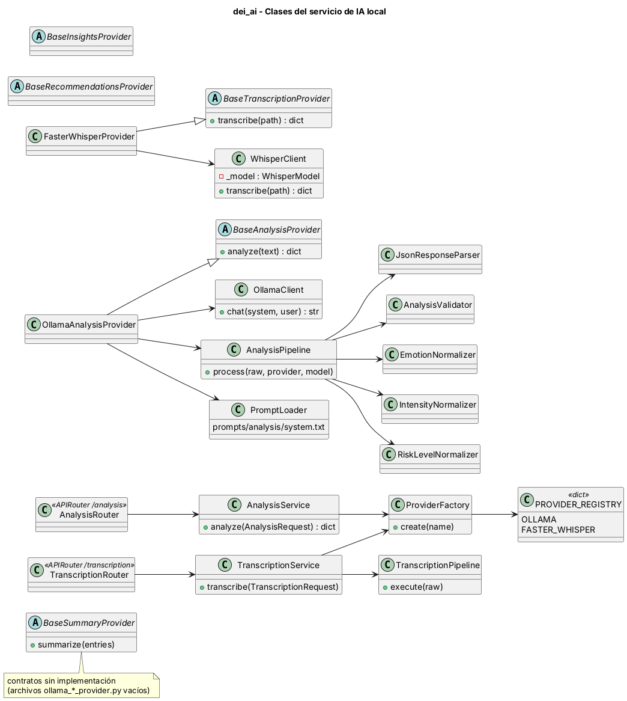
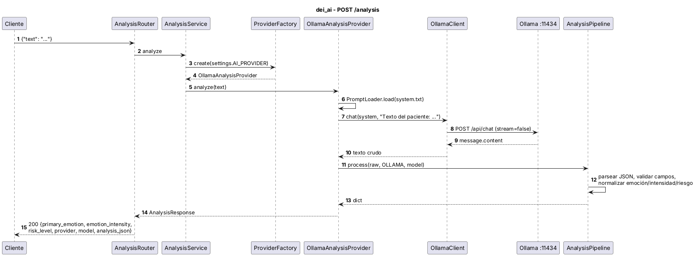
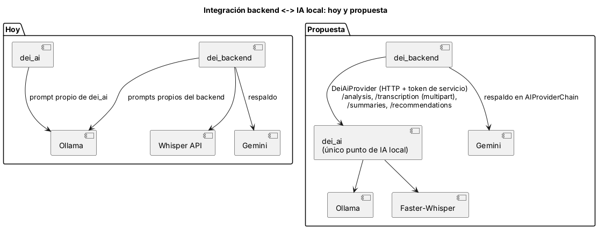

# DEI · IA local (`dei_ai`)

Servicio **FastAPI** que expone la IA local de DEI: análisis emocional con un
LLM servido por **Ollama** y transcripción de audio con **Faster-Whisper**.
Pensado para correr en la máquina con GPU (Nitro 5) y ser consumido por el
backend por HTTP.

Ver también: [arquitectura general](arquitectura-general.md) ·
[backend](backend.md) · [app](app.md).

---

## 1. Estructura

```
app/
  main.py                    FastAPI; en el arranque carga Faster-Whisper
  core/                      config (pydantic-settings, .env), startup, logging
  analysis/
    api/analysis_router.py   POST /analysis
    services/                AnalysisService
    pipeline/                AnalysisPipeline: parsear, validar, normalizar
    schemas/                 AnalysisRequest, AnalysisResponse, AnalysisData
  transcription/
    api/                     POST /transcription
    services/, pipeline/, schemas/
  providers/
    factory.py, registry.py  ProviderFactory + PROVIDER_REGISTRY
    analysis/                BaseAnalysisProvider, OllamaAnalysisProvider
    transcription/           BaseTranscriptionProvider, FasterWhisperProvider
    summaries/, recommendations/, insights/   contratos (implementaciones vacías)
  clients/
    ollama/ollama_client.py  POST {OLLAMA_URL}/api/chat
    whisper/whisper_client.py  WhisperModel cargado una vez por proceso
  prompts/analysis/system.txt  Prompt del análisis
  shared/                    enums, normalizadores, parser JSON, validador, excepciones
  tests/                     pytest (normalizadores)
```



**Patrones:** *Factory + Registry* para elegir el proveedor por nombre,
*Strategy* (cada proveedor implementa su contrato `Base*Provider`), *Pipeline*
para convertir la respuesta cruda del modelo en una respuesta válida, y cliente
*singleton* para que el modelo Whisper se cargue una sola vez.

## 2. API

### `POST /analysis`

Petición:

```json
{ "text": "Hoy me sentí muy solo en el trabajo..." }
```

Respuesta (`AnalysisResponse`):

```json
{
  "primary_emotion": "SOLEDAD",
  "emotion_intensity": "MEDIUM",
  "risk_level": "LOW",
  "provider": "OLLAMA",
  "model": "llama3.1:8b",
  "analysis_json": {
    "sentimientos": [], "pensamientos": [], "emociones": [],
    "patrones_de_comportamiento": [], "posibles_causas": [], "resumen": ""
  }
}
```

- `primary_emotion`: una de 22 emociones (`ALEGRIA`, `TRISTEZA`, `ANSIEDAD`,
  `MIEDO`, `IRA`, `ASCO`, `SORPRESA`, `CALMA`, `ESTRES`, `DESANIMO`, `CULPA`,
  `VERGUENZA`, `SOLEDAD`, `FRUSTRACION`, `CONFUSION`, `ESPERANZA`, `CONFIANZA`,
  `GRATITUD`, `AGOTAMIENTO`, `AMOR`, `PREOCUPACION`, `DESESPERANZA`). Es el
  mismo catálogo que `app/shared/emotions.py` del backend; `EmotionEnum.label`
  da el nombre con tildes que guarda el backend (`Estrés`).
- `emotion_intensity`: `LOW`, `MEDIUM`, `HIGH`.
- `risk_level`: `LOW`, `MEDIUM`, `HIGH`, `CRITICAL`.



### `POST /transcription`

```json
{ "audio_path": "C:/ruta/al/audio.m4a" }
```

Responde `{ "provider": "WHISPER", "model": "large-v3", "transcription_data":
{ "transcription": "...", "language": "es" } }`.

> Recibe una **ruta de archivo local**: solo funciona si el audio ya está en la
> misma máquina que `dei_ai`. Para el backend hace falta recibir el archivo por
> multipart (sección 6).

### `GET /`

Estado del servicio: nombre, versión y `running`.

## 3. Pipeline de análisis

1. `PromptLoader` carga `prompts/analysis/system.txt` (rol, formato JSON
   estricto, valores permitidos).
2. `OllamaClient.chat()` llama a `/api/chat` con `stream: false`. Timeout,
   conexión rechazada o HTTP de error se convierten en `AIProviderException`.
3. `JsonResponseParser` extrae el JSON aunque el modelo agregue texto.
4. `AnalysisValidator` exige `primary_emotion`, `emotion_intensity`,
   `risk_level` y `analysis_json` (objeto).
5. Los normalizadores llevan sinónimos y variantes a los enums
   (`EmotionNormalizer`, `IntensityNormalizer`, `RiskLevelNormalizer`).
6. Se agregan `provider` y `model`, y FastAPI valida contra `AnalysisResponse`.

La PR #1 de este repositorio ajusta el prompt con criterios de riesgo explícitos
y quita el rol de "psicólogo clínico" para que el modelo no diagnostique.

## 4. Configuración (`.env`)

| Variable | Por defecto | Notas |
|---|---|---|
| `HOST`, `PORT` | `127.0.0.1`, `8001` | Usa `0.0.0.0` para aceptar al backend desde otra máquina. |
| `AI_PROVIDER` | `OLLAMA` | Clave en `PROVIDER_REGISTRY`. |
| `OLLAMA_URL`, `OLLAMA_MODEL`, `OLLAMA_TIMEOUT` | `http://localhost:11434`, `llama3.1:8b`, `300` | |
| `OLLAMA_TEMPERATURE`, `OLLAMA_NUM_PREDICT` | `0.2`, `2048` | Definidas, pero el cliente aún no las envía a Ollama. |
| `WHISPER_MODEL`, `WHISPER_DEVICE`, `WHISPER_COMPUTE_TYPE` | `large-v3`, `cpu`, `int8` | Con GPU: `cuda` y `float16`. |
| `WHISPER_LANGUAGE`, `WHISPER_BEAM_SIZE`, `WHISPER_VAD_FILTER`, `WHISPER_CPU_THREADS` | `es`, `5`, `true`, `4` | |

## 5. Ejecutar

```bash
python -m venv .venv && .venv\Scripts\activate      # Linux/macOS: source .venv/bin/activate
pip install -r requirements.txt
ollama pull llama3.1:8b
uvicorn app.main:app --host 0.0.0.0 --port 8001
pytest
```

El primer arranque descarga el modelo Whisper desde Hugging Face. Notas:
`requirements.txt` está guardado en UTF-16 (conviene convertirlo a UTF-8 para
que `pip` lo lea en cualquier sistema) y `run.py` está vacío.

## 6. Integración con el backend

**Hoy el backend no llama a `dei_ai`.** Usa Ollama directamente y un servidor
Whisper compatible con OpenAI (ver `docs/ia-local.md` del backend). Para que
`dei_ai` sea el único punto de IA local:



**En `dei_ai`:**

1. `POST /transcription` con `UploadFile` (multipart) en lugar de `audio_path`.
2. Implementar `POST /summaries` y `POST /recommendations` (los contratos
   `BaseSummaryProvider` y `BaseRecommendationsProvider` ya existen).
3. Un token de servicio (`X-Service-Token`) para que solo el backend pueda
   llamarlo, y `GET /health` con el estado de Ollama y Whisper.
4. Emociones: ya alineadas. Los dos repos usan las mismas 22 emociones y los
   mismos sinónimos, con pruebas de contrato (PR #6 del backend y PR #3 de
   `dei_ai`).
5. Mover el `on_event("startup")` obsoleto a `lifespan`.

**En `dei_backend`:**

1. `DeiAiAnalysisProvider`, `DeiAiSummaryProvider`,
   `DeiAiRecommendationProvider` y `DeiAiTranscriptionProvider`, registrados en
   las fábricas actuales.
2. Agregar `DEI_AI` a `SUPPORTED_PROVIDERS` y configurar
   `AI_PROVIDER_CHAIN=DEI_AI,GEMINI` con `DEI_AI_URL` y `DEI_AI_TOKEN`.
3. Mantener en el backend el filtro de frases de riesgo y la decisión final del
   nivel de riesgo.

Como el contrato de respuesta de `dei_ai` ya coincide con lo que guarda el
backend (`primary_emotion`, `emotion_intensity`, `risk_level`, `provider`,
`model`, `analysis_json`), el cambio en el backend es pequeño.
